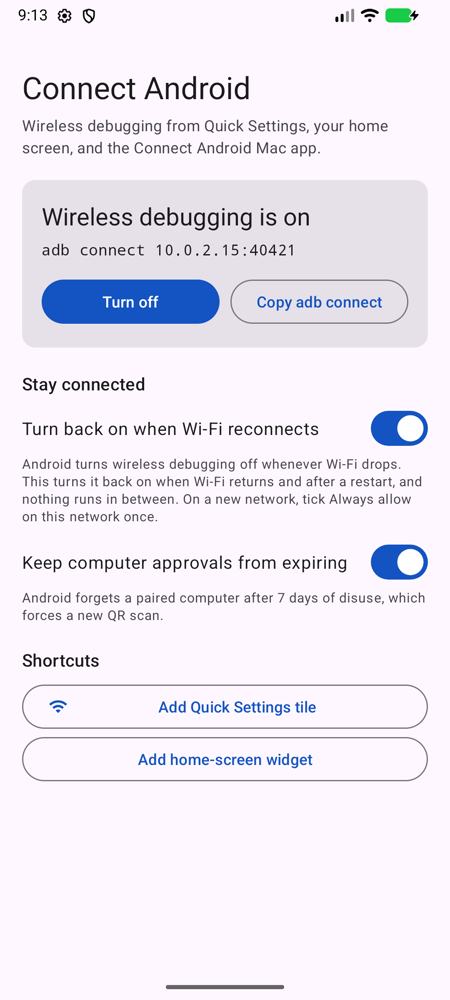
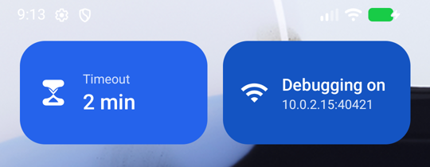
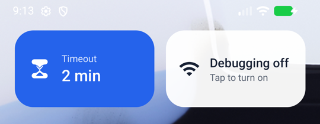
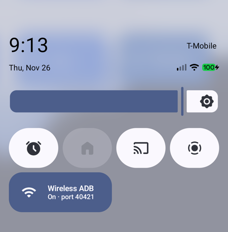

# Connect Android

An on-demand macOS utility for Android wireless debugging. Open the app from your Desktop, scan a QR code if pairing is needed, and close the window after connection. No menu-bar item, login item, or persistent app helper.

## Why I built it

I wanted to debug my app. I ended up debugging the connection.

I got tired of fighting wireless debugging setup in Android Studio, so I built a small Mac app for the connection step. **Less pairing. More building.**

### Watch the video

[](https://youtu.be/jyxFQRuv46U)

**[Watch on YouTube](https://youtu.be/jyxFQRuv46U)** · [Download the video (MP4)](https://raw.githubusercontent.com/StoneHub/connect-android/main/docs/media/connect-android-teaser.mp4) · [Download the app](https://github.com/StoneHub/connect-android/releases/latest)

Once connected, use ADB from your terminal or your coding agent's configured Android tools. Device control requires those tools or an MCP integration; this app provides the wireless connection. See the [video and walkthrough materials](docs/promotion.md) for the planned real-device demonstration.

Requires macOS 14 or newer, Android 11 or newer with Wireless debugging enabled, and Android SDK platform-tools (`adb`) installed on the Mac. Both devices must be on the same local network. This app does not bundle platform-tools or upload pairing credentials.

## Use

1. Open **Connect Android**.
2. If a QR code appears, open **Developer options → Wireless debugging → Pair device with QR code** on your phone and scan it.
3. Wait for the connected device name. Close the app; ADB retains the connection.

If macOS requests Local Network access, allow it. Network isolation or blocked multicast can prevent discovery. Details contains a bounded local diagnostic log; pairing passwords are excluded. Choose ADB lets you use an SDK installed elsewhere.

## Phone app

The `android/` folder holds the Connect Android phone app (Android 11+). It adds:

- A **Wireless ADB** Quick Settings tile and a home-screen widget that turn wireless debugging on or off and show the current port.
- **Stay connected**: Android turns wireless debugging off whenever Wi-Fi drops. With this on, the phone turns it back on when Wi-Fi returns and after a restart. It uses a one-shot network callback and a settings content trigger, so nothing runs in between.
- **Keep computer approvals from expiring**: stops Android from forgetting this Mac after 7 days of disuse, which otherwise forces a new QR scan.

Toggling wireless debugging needs `WRITE_SECURE_SETTINGS`, which only adb can grant. When the phone app is installed and not yet allowed, the Mac app shows **Allow Phone Controls** after connecting; one click runs the grant over the existing connection. The grant survives app updates and is removed on uninstall. You can also run it yourself:

```sh
adb shell pm grant com.monroestone.connectandroid android.permission.WRITE_SECURE_SETTINGS
```

Build and install the phone app:

```sh
cd android && ./gradlew installDebug
```

| App | Widget | Quick Settings |
|---|---|---|
|  | <br> |  |

## Connection policy

- Verify an existing online device before offering a new pairing session.
- Before showing a QR code, try the last working address, then the phone's LAN mDNS record, then the phone's Tailscale address. Wireless debugging picks a new port each time, so the Mac finds it with a bounded TCP scan of only your own online Android tailnet devices (never shared devices). Only already-paired phones can verify.
- Preserve existing ADB transports. Refresh the server automatically only when none are listed.
- Generate fresh local pairing credentials; discover the exact service requested by the QR code.
- Pair and connect through separate endpoints, then run a device command before reporting success.
- Bound discovery and subprocess work; closing the app cancels its work without stopping the ADB server.

Android documents the protocol in [Architecture of ADB Wifi](https://android.googlesource.com/platform/packages/modules/adb/+/HEAD/docs/dev/adb_wifi.md).

## Development

Use Xcode and XcodeGen. See `scripts/` for build/install commands and `Vendor/` for the pinned development-only feedback dependency. Release packaging must exclude feedback UI and metadata. Development feedback does not add controls to the normal app layout.

Public releases are signed with a Developer ID certificate. Notarization status is stated in each release's notes.

Build and install locally (leaving the app closed):

```sh
python3 scripts/build-install.py --no-launch
```

Run isolated connection tests without touching a phone or the real ADB server:

```sh
mkdir -p .build
swiftc Sources/PairingEngine.swift Tests/EngineTests.swift -parse-as-library -o .build/engine-tests
.build/engine-tests
```

Development dependency provenance: [Vendor/PROVENANCE.md](Vendor/PROVENANCE.md).
